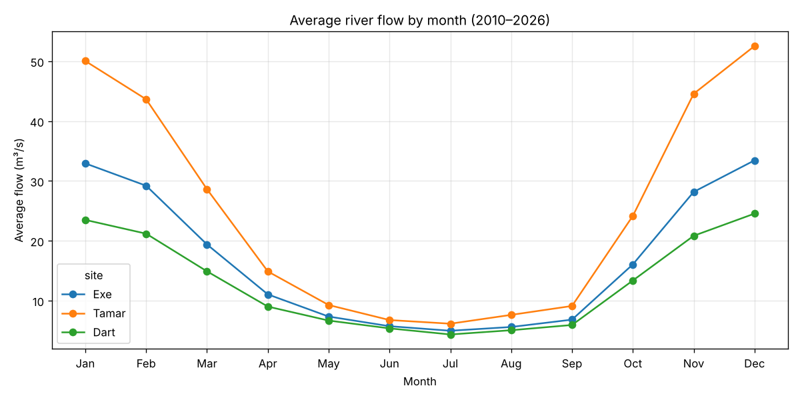
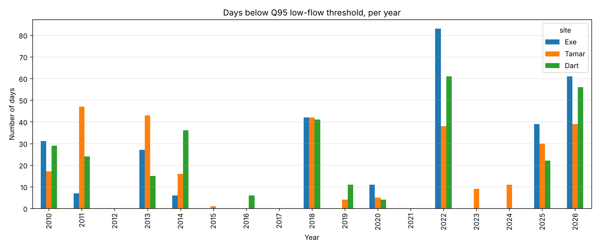

# South West River Flows & Drought Risk Analysis

**How have river flows in South West England behaved since 2010, when are low-flow risk periods, and how unusual is autumn 2026?**

Analysis of 17 years of daily Environment Agency river flow data for three major South West catchments, covering data quality checks, low-flow (drought) analysis and a simple, tested forecast.

## Headline finding

> Early-October 2026 flows on the River Tamar and River Dart were the **lowest for the time of year in the 17-year record**, at around **17–18% of normal**, following a similarly dry autumn in 2025.

*Note: recent readings are provisional ("Unchecked") and may be revised by the Environment Agency.*

## Data

| Source | Station | Period | Records |
|---|---|---|---|
| River Exe | Thorverton | 2010–2026 | 6,138 daily |
| River Tamar | Gunnislake | 2010–2026 | 6,138 daily |
| River Dart | Austins Bridge | 2010–2026 | 6,138 daily |
| Rainfall | Exeter Met Office | 2017–2026 | 3,467 daily |

**Total: 21,881 records.** Source: [Environment Agency Hydrology Data Explorer](https://environment.data.gov.uk/hydrology/explore), Open Government Licence.

## Method

1. **Data quality checks:** counted Environment Agency quality flags (Good, Estimated, Suspect, Unchecked) per site, and checked for missing days and duplicates.
2. **Cleaning:** suspect readings were set to blank rather than estimated, to avoid inventing data. Official EA estimates were kept.
3. **Analysis:** monthly seasonality, low-flow days per year using the **Q95** threshold (the flow exceeded 95% of the time), and a same-period comparison of October 2026 with previous years.
4. **Forecast:** a linear regression model predicting monthly flow from the month and the previous month's flow. It was trained on 2010–2022, tested on 2023–2026, and compared with a seasonal-average baseline.

## Key findings

### 1. Data quality
- No missing days or duplicates.
- **The Tamar had 108 consecutive "Suspect" readings (11 March to 26 June 2025)**, likely a gauge issue. These were excluded, so Tamar's 2025 low-flow count is probably understated.

### 2. Seasonality
Flows peak in December and January and are lowest in July, about a tenfold difference. The steepest fall is from March to May, so a dry spring leaves rivers low going into summer.

### 3. Drought risk
2022 was the worst year (about 80 low-flow days on the Exe). With about 10 weeks still to go, **2026 is already the second-worst year** on the Exe and Dart.

### 4. Forecast
- The model beat the seasonal-average baseline by only **about 3%** (MAE 7.2 vs 7.4 m³/s), because future rainfall, the main driver, isn't in the inputs.
- November 2026 forecast for the Exe: **about 14 m³/s (likely range 8–24)**, against a normal of about 27.
- After the six driest Octobers on record, November always recovered to 15–38 m³/s. **Recovery is likely but not guaranteed**, because October 2026 is drier than any October in the record.

## Limitations
- The rainfall record starts in 2017.
- Three gauging stations give a regional picture, not a full catchment model.
- October 2026 data is provisional.
- The forecast does not include weather forecasts or groundwater levels, which would be the next improvement.

## Tools
Python (pandas, matplotlib, scikit-learn), Google Colab.

## How to run
1. Open `SW_River_Flows.ipynb` in Google Colab.
2. Upload the four raw CSV files (`exe_thorverton.csv`, `tamar_gunnislake.csv`, `dart_austinsbridge.csv`, `rainfall_exeter.csv`) from the `data` folder when prompted.
3. Select **Runtime → Run all**.

---
*Author: Jayanth Vorsu · [LinkedIn](https://www.linkedin.com/in/jayanth-vorsu)*
